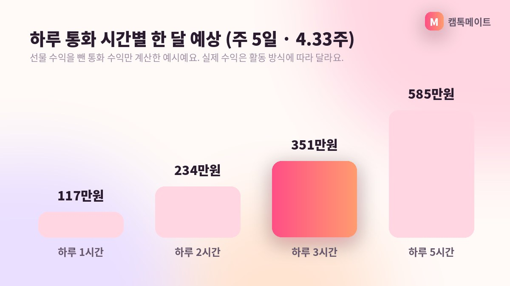

## 캠톡 수익의 기본 단위는 '1분 900캐시'

캠톡 부업에 관심이 생기면 가장 먼저 궁금한 게 "그래서 얼마나 벌 수 있는데?"일 거예요. 기준은 단순합니다. 캠톡커가 이용자와 1:1 영상통화를 하면 1분당 900캐시가 적립되고, 1캐시는 1원으로 계산돼요. 10분이면 9,000원, 1시간이면 54,000원입니다.

*AI로 만든 예시 이미지*

여기에 이용자가 보내는 아이템 선물과 팔로워에게 판매하는 유료 스토리 수익이 더해집니다. 다만 이 글에서는 가장 계산이 명확한 영상통화만 놓고 예시를 들어 볼게요. 아래 숫자는 '통화가 그만큼 연결됐을 때'를 가정한 계산 예시이지, 보장되는 금액이 아니라는 점을 먼저 말씀드립니다.

## 시간대별 계산 예시, 하루 30분부터

**예시 1. 직장인 A씨, 퇴근 후 하루 30분**. 평일 저녁에 30분씩 통화가 연결된다고 가정하면 하루 27,000원이에요. 한 달에 평일 20일을 활동하면 540,000원까지 계산됩니다. 부담 없는 시간으로 시작하는 분들이 많이 떠올리는 수준이에요.

**예시 2. 대학생 B씨, 하루 1시간**. 하루 1시간이면 54,000원, 20일이면 1,080,000원까지 계산돼요. **예시 3. 프리랜서 C씨, 주말 집중형**. 토·일 이틀만 각 2시간씩 통화하면 하루 108,000원, 한 달 8일이면 864,000원 수준입니다. 활동 요일과 시간을 본인 생활에 맞춰 설계할 수 있다는 게 핵심이에요.

- **하루 30분 × 20일**: 540,000원까지 계산 가능
- **하루 1시간 × 20일**: 1,080,000원까지 계산 가능
- **주말 2시간 × 8일**: 864,000원까지 계산 가능
- 모두 통화 연결 시간 기준 예시이며, 선물·유료 스토리는 별도

## 계산대로 되지 않는 이유도 알아두세요

앱을 켜 둔 시간과 실제 통화가 연결된 시간은 다릅니다. 통화 요청이 들어와야 분당 적립이 시작되니, 처음 몇 주는 팔로워를 모으며 통화 시간이 서서히 늘어나는 흐름이 일반적이에요. 그래서 "첫 달부터 100만원"처럼 단정하는 말은 믿지 않으시는 게 좋습니다.

반대로 통화 외 수익이 더해지면 계산보다 많아질 수도 있어요. 스토리 공개 범위를 '팔로워 유료'로 두면 사진·영상·음성 스토리를 판매할 수 있고, 통화 중 받는 아이템 선물도 수익으로 적립됩니다. 글로벌 매칭과 번역 기능 덕분에 국내 시간대가 조용한 심야에도 해외 이용자와 연결될 수 있다는 점도 참고하세요.

## 실수령액은 어떻게 되나요?

예시를 하나 더 들면, 하루 중 낮 1시간과 저녁 1시간을 나눠 활동하는 방식도 있어요. 이 경우 하루 2시간, 108,000원까지 계산되고 20일이면 2,160,000원까지 숫자가 올라갑니다. 다만 하루 2시간 통화가 꾸준히 연결되려면 팔로워가 어느 정도 쌓인 뒤라는 점을 감안해 주세요.

적립된 캐시는 1만원부터 1만원 단위로 출금할 수 있어요. 낮 시간에 신청하면 30분 안팎으로 입금되고, 심야에 신청한 건은 다음 날 오전 9시에 일괄 입금됩니다. 3.3% 원천징수와 송금 수수료는 캠톡메이트가 부담하기 때문에 신청한 금액이 그대로 들어와요.

캠톡메이트 소속으로 활동하면 가입비·관리비·교육비가 0원이고, 의무 시간이나 위약금도 없습니다. 그러니 위 예시 중 어느 하나를 '목표'로 정해 두고, 전담 매니저와 상의하며 활동 시간을 조절해 가시면 됩니다.

## 자주 묻는 질문

### 통화 시간이 짧게 끊기면 어떻게 계산되나요?

분당 900캐시가 기준이라 짧은 통화도 연결된 시간만큼 적립됩니다. 짧은 통화가 여러 번 모이면 결국 합산 시간으로 계산돼요.

### 직접 앱에서 가입해도 같은 수익이 나오나요?

아니요. 앱스토어에서 직접 가입하면 일반 이용자 계정이 되어 수익 활동이 불가능해요. 캠톡메이트 초대 링크로 가입해야 캠톡커 계정이 됩니다.

**캠톡커 활동이 궁금하다면 캠톡메이트 상담 창구로 편하게 문의해 주세요.**
