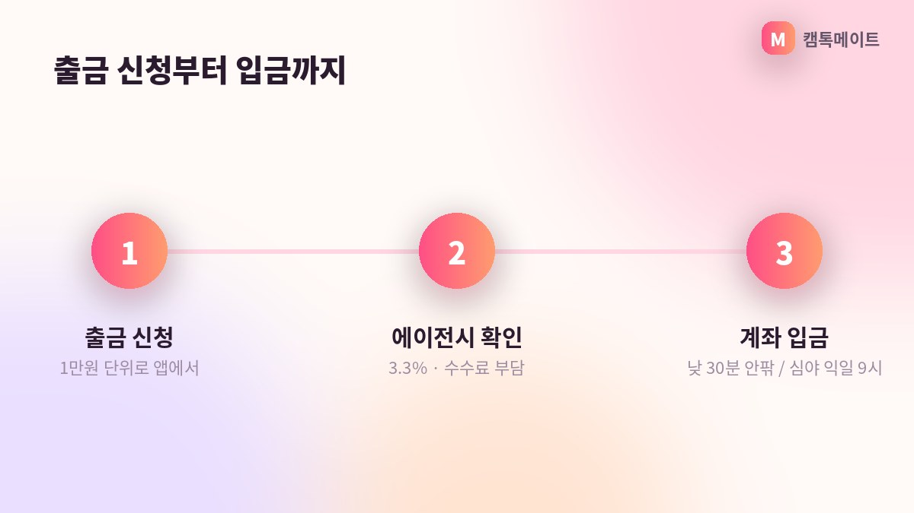

## 캠톡 출금, 얼마부터 언제 들어오나요

캠톡커 활동으로 쌓인 캐시(1캐시=1원)는 1만원부터 출금할 수 있어요. 단위는 1만원이라서 10,000원, 20,000원처럼 신청하게 됩니다. 영상통화 1분당 900캐시가 적립되니, 통화 12분 정도면 첫 출금 기준인 1만원이 넘어요.

*AI로 만든 예시 이미지*

입금 속도도 많이 묻는 부분입니다. 낮 시간에 출금을 신청하면 30분 안팎으로 입금돼요. 심야에 신청한 건은 모아서 다음 날 오전 9시에 일괄 입금됩니다. 즉, 오후에 활동하고 바로 신청하면 당일 저녁에 계좌에서 확인할 수 있는 흐름이에요.

## 3.3% 원천징수, 누가 내나요

세금 이야기가 나오면 어렵게 느끼는 분이 많은데, 캠톡커가 알아둘 내용은 두 가지뿐이에요. 하나는 출금 때 적용되는 3.3% 원천징수, 다른 하나는 매년 5월의 종합소득세 신고입니다. 하나씩 풀어 볼게요.

캠톡커는 회사에 고용된 직원이 아니라 개인이 소득을 얻는 구조라서, 세법상 사업소득으로 분류돼요. 일반적으로 프리랜서가 대가를 받을 때 3.3%(소득세 3% + 지방소득세 0.3%)를 원천징수하는 것과 같은 방식입니다.

캠톡메이트에서는 이 3.3% 원천징수와 송금 수수료를 에이전시가 부담해요. 예를 들어 50,000원을 출금 신청하면 50,000원이 그대로 입금됩니다. 수수료를 빼고 입금된다고 생각하는 분이 많은데, 캠톡메이트 소속이라면 신청 금액과 입금 금액이 같아요.

- **출금 단위**: 1만원부터 1만원 단위
- **낮 시간 신청**: 30분 안팎 입금
- **심야 신청**: 다음 날 오전 9시 일괄 입금
- **3.3% 원천징수·송금 수수료**: 에이전시 부담
- **종합소득세 신고**: 매년 5월, 본인이 직접

## 종합소득세 신고는 본인이 해요

원천징수와 별개로, 소득이 얼마인지 스스로 파악해 두면 신고 때 편해요. 출금 내역을 월별로 메모해 두는 습관을 권합니다.

원천징수를 에이전시가 부담하더라도 연 소득에 대한 종합소득세 신고는 캠톡커 본인이 해야 합니다. 보통 매년 5월에 전년도 소득을 신고하는데, 홈택스에서 사업소득으로 조회되기 때문에 처음 해 보는 분도 안내에 따라 진행할 수 있어요.

소득 규모에 따라 추가 납부가 생길 수도, 환급을 받을 수도 있습니다. 다른 직장 소득이 있는 분은 합산해서 신고하게 되니, 본인 상황에 맞는 부분은 세무서나 세무 전문가에게 확인하시는 걸 권해요. 캠톡메이트 전담 매니저도 정산 내역 확인은 도와드릴 수 있습니다.

## 출금 전에 알아두면 좋은 것

출금 신청은 본인 명의 계좌로만 가능하고, 가입 시 계좌 정보를 등록하게 돼요. 캐시는 영상통화뿐 아니라 아이템 선물과 유료 스토리 판매로도 쌓이는데, 어디서 적립됐든 합산해서 출금합니다.

출금 시점은 자유롭게 정할 수 있어요. 매일 조금씩 출금하는 분도 있고, 한 달 치를 모았다가 한 번에 신청하는 분도 있습니다. 어느 쪽이든 수수료가 빠지지 않으니 본인 생활비 흐름에 맞춰 정하시면 돼요. 통화 외에 선물이나 유료 스토리로 적립된 캐시도 같은 조건으로 출금됩니다.

가입비·관리비·교육비가 0원이기 때문에 출금 과정에서 따로 빠져나가는 금액은 없어요. 의무 시간이나 위약금도 없으니, 활동한 만큼만 쌓이고 쌓인 만큼 출금하는 단순한 구조라고 보시면 됩니다.

## 자주 묻는 질문

### 심야에 활동하면 출금이 늦어지나요?

심야에 신청한 건만 다음 날 오전 9시에 입금되고, 다음 날 낮에 신청하면 30분 안팎으로 들어와요. 하루 이상 지연되는 구조는 아닙니다.

### 원천징수 영수증은 받을 수 있나요?

사업소득 원천징수 내역은 홈택스에서 조회할 수 있어요. 별도 서류가 필요하면 전담 매니저에게 요청하시면 됩니다.

**캠톡커 활동이 궁금하다면 캠톡메이트 상담 창구로 편하게 문의해 주세요.**
