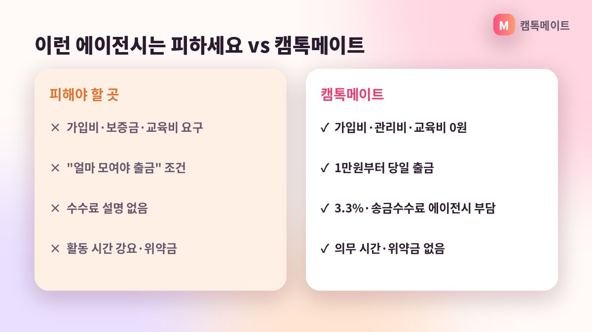

## 왜 캠톡은 에이전시 소속이 필요할까요

캠톡은 만 19세 이상 성인이 1:1 영상대화를 나누는 앱인데, 수익 활동은 아무 계정이나 할 수 있는 게 아니에요. 앱스토어에서 직접 설치해 가입하면 일반 이용자 계정이 되고, 캠톡커로 수익을 내려면 공식 에이전시의 초대 링크로 가입해야 합니다. 그래서 '캠톡 소속'을 어디로 할지가 활동의 출발점이 돼요.

*AI로 만든 예시 이미지*

문제는 검색하면 에이전시라고 소개하는 곳이 여럿 보인다는 점입니다. 조건이 제각각이라 비교하기 어렵다는 분들이 많아요. 아래 다섯 가지만 순서대로 확인하면 큰 실수는 피할 수 있습니다.

## 확인 1. 캠톡 공식 에이전시가 맞는지

가장 먼저 볼 것은 캠톡 운영사(메이트네트웍스)가 인정한 공식 에이전시인지 여부예요. 공식 에이전시가 아니면 초대 링크 자체가 유효하지 않거나, 중간에서 수익을 가져가는 구조일 수 있습니다. 회사명과 소재지가 분명하게 공개돼 있는지도 함께 보세요.

캠톡메이트는 캠톡 공식 에이전시로, 서울 강남의 오스트빅 주식회사가 운영합니다. 사업자 정보를 홈페이지에 공개하고 있으니 가입 전에 직접 확인하실 수 있어요.

## 확인 2·3. 비용과 의무 조건

두 번째는 돈을 먼저 내라고 하는지입니다. 가입비, 관리비, 교육비, 장비비 같은 명목으로 선입금을 요구한다면 한 번 더 의심해 보세요. 캠톡메이트는 가입비·관리비·교육비 모두 0원이고, 활동에 필요한 건 스마트폰뿐입니다.

세 번째는 의무 활동 시간과 위약금이에요. "하루 몇 시간 이상 접속" 같은 조건이 붙거나, 그만둘 때 위약금을 물리는 계약이라면 부업으로 가볍게 시작하기 어렵습니다. 캠톡메이트는 의무 시간과 위약금이 없어서 본인 일정에 맞춰 활동하고, 쉬고 싶을 때 쉴 수 있어요.

- **공식 여부**: 캠톡 공식 에이전시인지, 회사명·소재지 공개 여부
- **비용**: 가입비·관리비·교육비 0원인지
- **의무 조건**: 의무 시간·위약금 없는지
- **정산**: 1분 900캐시 그대로 적립되는지, 세금·수수료 부담 주체
- **관리**: 전담 매니저 1:1 관리가 있는지

## 확인 4·5. 정산 조건과 매니저 관리

네 번째는 정산입니다. 캠톡의 기본 단가는 영상통화 1분당 900캐시(1캐시=1원)예요. 이 금액이 그대로 적립되는지, 출금은 얼마부터 가능한지, 3.3% 원천징수와 송금 수수료를 누가 부담하는지를 물어보세요. 캠톡메이트는 1만원부터 1만원 단위로 출금할 수 있고, 낮 시간 신청은 30분 안팎, 심야 신청분은 다음 날 오전 9시에 입금됩니다. 원천징수와 송금 수수료는 에이전시가 부담해요.

정산과 관련해 한 가지 더, 출금 조건을 말로만 듣지 말고 홈페이지나 안내 자료에 적혀 있는지 확인하세요. 조건이 문서로 공개돼 있는 곳이 나중에 말이 바뀔 가능성도 낮습니다. 디지털타임스(2024.02) 등 언론에 모집 소식이 보도된 이력도 참고가 될 수 있어요.

다섯 번째는 가입 후 관리입니다. 초대 링크만 보내고 끝나는 곳과, 전담 매니저가 1:1로 스토리 구성이나 활동 시간을 함께 고민해 주는 곳은 차이가 커요. 처음 시작하는 분일수록 질문할 사람이 있는지가 중요합니다.

## 자주 묻는 질문

### 에이전시를 나중에 옮길 수 있나요?

계약 조건에 따라 다르기 때문에 가입 전에 반드시 확인해야 하는 항목이에요. 캠톡메이트는 위약금이 없어 활동을 중단하는 데 부담이 없습니다.

### 에이전시마다 통화 단가가 다른가요?

캠톡의 단가는 1분당 900캐시로 정해져 있어요. 단가 자체보다는 비용, 의무 조건, 정산 속도, 관리 방식에서 차이가 납니다.

**캠톡커 활동이 궁금하다면 캠톡메이트 상담 창구로 편하게 문의해 주세요.**
