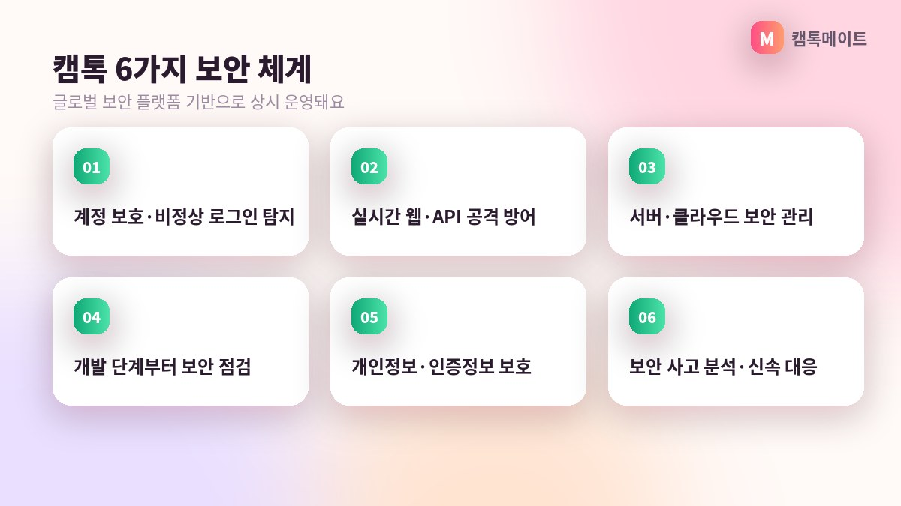

## 가장 많이 받는 질문, "캠톡 안전한가요?"

캠톡커 활동을 고민하는 분들이 수익보다 먼저 묻는 게 안전이에요. 영상통화라는 특성상 "내 얼굴이 어디에 남지 않을까", "이상한 사람을 만나면 어떡하지" 같은 걱정이 자연스럽습니다. 이 글은 캠톡이 실제로 제공하는 보호 장치를 과장 없이 정리한 내용이에요.

*AI로 만든 예시 이미지*

캠톡은 2012년 설립된 메이트네트웍스가 운영하고, App Store·Google Play·One Store에 정식 출시된 앱입니다. 운영사 발표 기준 누적 1억 콜을 넘긴 서비스인 만큼 안전 기능도 꾸준히 보강돼 왔어요.

## 익명: 본명이 아닌 닉네임으로 활동해요

캠톡커는 닉네임으로 활동합니다. 이용자에게 본명이나 연락처가 노출되지 않고, 프로필과 스토리 모두 닉네임 기준으로 운영돼요. 개인정보는 에이전시와 운영사 사이에서만 정산 목적으로 관리됩니다.

얼굴 노출이 부담스러운 분은 마스크나 소품으로 얼굴을 가린 채 활동할 수 있어요. 실제로 눈만 보이게 하거나 캐릭터 소품을 쓰는 캠톡커도 있습니다. 스토리 공개 범위도 전체 / 팔로워 무료 / 팔로워 유료 중 고를 수 있어서, 공개 수준을 본인이 정할 수 있어요.

## 캡처 감지·워터마크·추적 대응

영상통화 중 상대가 화면을 캡처하거나 녹화하려는 시도를 감지하는 기능이 있어요. 화면에는 워터마크가 적용되어, 혹시 유출이 발생하더라도 어디서 나온 화면인지 추적해 대응할 수 있습니다. 무단 촬영을 완전히 막는 기술은 세상에 없지만, 시도 자체를 억제하고 사후 대응이 가능한 구조라는 점이 중요해요.

이 기능들은 글로벌 보안 플랫폼을 기반으로 한 6중 보안 체계 안에서 운영됩니다. 계정 보호, 공격 탐지, 서버 보안, 개발 단계 점검, 개인정보 보호, 사고 대응의 여섯 단계로 나뉘어 있어요.

- **닉네임 활동**: 본명·연락처 비공개
- **캡처 감지·워터마크**: 무단 촬영 억제와 추적 대응
- **차단·신고**: 불쾌한 이용자는 즉시 차단, 운영팀 신고
- **6중 보안**: 계정 보호부터 사고 대응까지
- **마스크·소품 활동**: 얼굴 노출 범위를 직접 조절

## 차단과 신고는 캠톡커의 권리예요

안전 기능은 운영사가 서비스 전반에 적용하는 것이라, 캠톡커가 따로 설정을 켜거나 비용을 낼 필요가 없어요. 가입과 동시에 같은 보호 체계 안에서 활동하게 됩니다.

통화 중 무례하거나 불쾌한 요구를 하는 이용자는 바로 차단할 수 있고, 신고하면 운영팀이 조치합니다. 차단된 이용자는 더 이상 쪽지나 통화 신청을 보낼 수 없어요. "참고 통화해야 수익이 되지 않을까" 생각하실 수 있지만, 캠톡메이트는 불편한 통화를 이어가지 말고 끊으라고 안내해요.

또 하나, 쪽지나 통화 중에 개인 연락처나 다른 메신저 아이디를 물어보는 이용자가 있다면 알려주지 않는 것이 원칙이에요. 캠톡 안에서만 소통해야 캡처 감지·워터마크·차단 같은 보호 장치가 그대로 작동합니다. 앱 밖으로 나가는 순간 보호 범위를 벗어난다고 생각하시면 돼요.

가입 후에는 전담 매니저가 1:1로 붙어서 이런 상황이 생겼을 때 어떻게 대응하면 되는지 함께 정리해 드립니다. 의무 시간이나 위약금이 없기 때문에, 컨디션이 좋지 않은 날은 쉬어도 불이익이 없어요.

## 자주 묻는 질문

### 해외 이용자와 연결되면 더 위험하지 않나요?

글로벌 매칭과 대화 번역 기능이 있어서 해외 이용자와도 대화할 수 있지만, 차단·신고·캡처 감지 기능은 국내외 구분 없이 똑같이 적용돼요.

### 활동을 그만두면 올린 스토리는 어떻게 되나요?

스토리는 본인이 직접 삭제하거나 공개 범위를 바꿀 수 있어요. 활동 중단 시 처리 방법은 전담 매니저에게 문의하면 안내받을 수 있습니다.

**캠톡커 활동이 궁금하다면 캠톡메이트 상담 창구로 편하게 문의해 주세요.**
