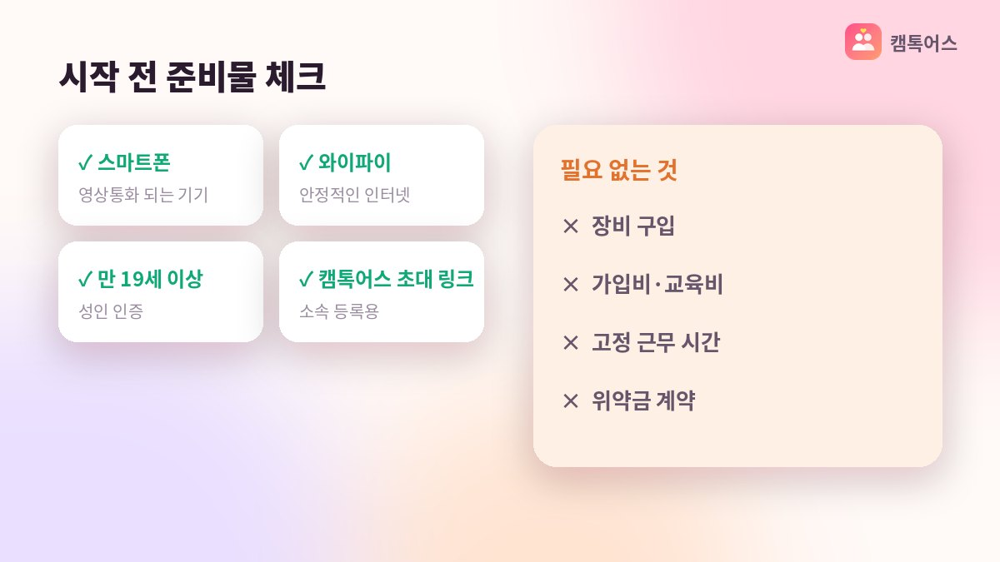

## 재택 부업으로 캠톡이 맞는 사람

집에서 스마트폰 하나로 할 수 있는 재택 부업을 찾다 보면 캠톡을 만나게 돼요. 캠톡은 만 19세 이상 성인이 1:1 영상대화를 나누는 앱이고, 캠톡커로 활동하면 영상통화 1분당 900캐시(1캐시=1원)가 적립됩니다. 출퇴근이 없고, 정해진 근무 시간도 없어서 본인 생활 리듬에 맞출 수 있어요.

*AI로 만든 예시 이미지*

대화를 나누는 걸 좋아하고, 하루 30분이라도 꾸준히 시간을 낼 수 있는 분이라면 시작해 볼 만합니다. 반대로 얼굴을 완전히 가리고 싶다면 마스크·소품으로 노출을 줄이는 방법이 있고, 그래도 부담스럽다면 음성 스토리 위주로 활동 범위를 좁힐 수도 있어요.

## 1단계. 캠톡어스 초대 링크로 가입

여기서 가장 많이 실수하는 지점이 있어요. 앱스토어에서 캠톡을 직접 설치해 가입하면 일반 이용자 계정이 만들어져서 수익 활동을 할 수 없습니다. 캠톡커 계정은 공식 에이전시의 초대 링크를 통해서만 만들어져요.

캠톡어스에 상담을 신청하면 전담 매니저가 초대 링크를 보내 드리고, 가입 절차를 1:1로 안내합니다. 가입비·관리비·교육비는 0원이고 의무 시간이나 위약금도 없으니, 준비물은 스마트폰과 본인 명의 계좌뿐이에요.

## 2단계. 프로필과 첫 스토리 준비

가입이 끝나면 닉네임과 프로필을 정합니다. 본명은 쓰지 않고, 이용자에게는 닉네임만 보여요. 그다음 사진·영상·음성 중 편한 형태로 첫 스토리를 올리면 됩니다. 처음부터 완벽할 필요는 없고, 인사 한마디를 담은 짧은 영상이나 사진 한 장이면 충분해요.

스토리 공개 범위는 전체 / 팔로워 무료 / 팔로워 유료 중에서 고를 수 있어요. 시작 단계에서는 전체 공개로 팔로워를 모으고, 나중에 유료 스토리를 추가하는 순서를 매니저가 함께 잡아 드립니다.

- **1단계**: 캠톡어스 초대 링크로 가입 (직접 가입 시 수익 불가)
- **2단계**: 닉네임·프로필 설정, 첫 스토리 업로드
- **3단계**: 쪽지 응답과 첫 1:1 영상통화
- **4단계**: 1만원 이상 쌓이면 출금 신청

## 3단계. 첫 영상통화, 4단계. 첫 출금

스토리를 본 이용자가 팔로우하고 쪽지나 통화 신청을 보내면 활동이 시작돼요. 통화는 연결된 시간만큼 1분당 900캐시가 쌓이고, 통화 중 아이템 선물을 받으면 그것도 수익으로 적립됩니다. 불쾌한 이용자는 차단·신고하면 되고, 캡처 감지와 워터마크 기능이 기본으로 적용돼 있어요.

캐시가 1만원을 넘으면 1만원 단위로 출금을 신청할 수 있습니다. 낮 시간에 신청하면 30분 안팎, 심야 신청분은 다음 날 오전 9시에 입금돼요. 3.3% 원천징수와 송금 수수료는 캠톡어스가 부담하니 신청한 금액이 그대로 들어옵니다. 다만 매년 5월 종합소득세 신고는 본인이 하셔야 해요.

첫 달의 목표는 금액보다 습관이에요. 매일 정해진 시간에 스토리를 하나 올리고, 들어온 쪽지에 답하는 것만으로도 팔로워가 조금씩 늘어납니다. 통화 요청이 들어오기 시작하면 하루 30분을 기준으로 활동 시간을 조금씩 늘려 가세요. 전담 매니저가 활동 기록을 보며 스토리 방향이나 활동 시간대를 함께 조정해 드립니다.

## 자주 묻는 질문

### 첫 출금까지 보통 얼마나 걸리나요?

통화 12분 정도면 1만원이 넘기 때문에 첫 통화를 한 날 바로 출금할 수도 있어요. 다만 팔로워가 쌓여 통화 요청이 안정적으로 들어오기까지는 사람마다 기간이 달라요.

### 컴퓨터나 장비가 필요한가요?

스마트폰만 있으면 됩니다. 캠톡은 App Store·Google Play·One Store에서 설치할 수 있고, 별도 장비 구매를 요구하지 않아요.

**캠톡커 활동이 궁금하다면 캠톡어스 상담 창구로 편하게 문의해 주세요.**
