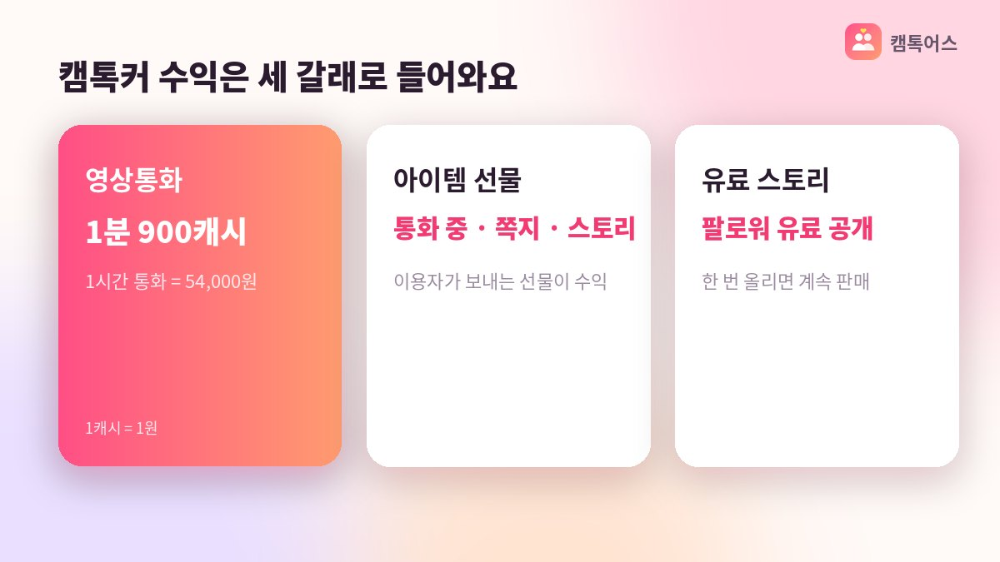

## 캠톡커는 캠톡의 공식 크리에이터예요

캠톡(CamTalk)은 만 19세 이상 성인 남녀가 스마트폰으로 1:1 영상대화를 나누는 앱입니다. 2012년 설립되어 20여 개의 앱을 운영하는 메이트네트웍스가 만들었고, 퍼블리셔는 비씨이노베이션이에요. App Store·Google Play·One Store에서 내려받을 수 있습니다. 운영사 발표 기준 누적 영상통화는 2025년 5월에 1억 콜을 넘었고, 2026년 11월 기준 구글플레이 데이트 카테고리 최고 매출 2위에 올라 있는 서비스입니다.

*AI로 만든 예시 이미지*

캠톡커는 이 앱 안에서 활동하는 공식 크리에이터를 부르는 이름이에요. 일반 이용자와 달리 스토리를 올리고, 팔로워를 모으고, 영상통화와 선물로 수익을 얻을 수 있는 계정입니다. 흔히 '캠톡 크리에이터'라고도 부르는데 같은 뜻이라고 보시면 됩니다.

## 캠톡커가 하는 일은 크게 세 가지입니다

첫 번째는 스토리 업로드예요. 사진·영상·음성 형태의 '스토리'를 올리면 이용자들이 보고 팔로우를 하게 됩니다. 일상 사진 한 장, 짧은 인사 영상, 목소리만 담은 음성 스토리까지 형식은 자유로워요. 꾸준히 올릴수록 팔로워가 쌓이는 구조입니다.

두 번째는 팔로워와의 소통이에요. 팔로우한 이용자는 쪽지를 보내거나 1:1 영상통화를 신청할 수 있습니다. 세 번째는 영상통화 자체인데, 캠톡커 수익의 중심이 되는 활동입니다. 글로벌 매칭과 대화 번역 기능이 있어서 해외 이용자와도 대화가 가능해요.

## 수익 구조는 통화·선물·유료 스토리

캠톡커의 수익은 세 갈래로 들어옵니다. 가장 큰 축은 영상통화로, 1분당 900캐시(1캐시=1원)가 적립돼요. 1시간을 통화하면 54,000원이 되는 셈입니다. 여기에 이용자가 보내는 아이템 선물 수익이 더해집니다.

스토리는 공개 범위를 전체 / 팔로워 무료 / 팔로워 유료 중에서 고를 수 있어요. 유료 스토리로 설정하면 팔로워에게 판매가 가능해서, 통화를 하지 않는 시간에도 수익이 생길 수 있는 구조입니다. 물론 얼마가 될지는 활동 시간과 팔로워 수에 따라 달라지니 '이만큼 벌 수 있다'기보다는 '이런 경로가 있다'로 이해해 주세요.

- **영상통화**: 1분당 900캐시, 1시간 통화 시 54,000원
- **아이템 선물**: 이용자가 보내는 선물이 수익으로 적립
- **유료 스토리**: 팔로워에게 판매 가능한 사진·영상·음성
- **출금**: 1만원부터 1만원 단위, 낮 시간 신청은 30분 안팎

## 에이전시 소속이어야 수익 활동이 가능해요

한 가지 꼭 알아두실 점이 있습니다. 앱스토어에서 캠톡을 직접 설치해 가입하면 일반 이용자 계정이 만들어져서 수익 활동을 할 수 없어요. 캠톡커로 활동하려면 공식 에이전시의 초대 링크로 가입해야 합니다.

캠톡어스는 캠톡의 공식 에이전시로, 서울 강남에 있는 오스트빅 주식회사가 운영합니다. 가입비·관리비·교육비는 0원이고, 의무 활동 시간이나 위약금도 없어요. 가입 후에는 전담 매니저가 1:1로 활동을 도와드립니다. 2024년 2월 디지털타임스에서 캠톡커 모집 소식이 보도되기도 했고, 2025년 4월 비즈니스코리아는 여성 크리에이터가 전월 대비 15% 늘었다고 전했습니다.

## 자주 묻는 질문

### 얼굴을 꼭 공개해야 하나요?

아니요. 닉네임으로 활동하고, 마스크나 소품으로 얼굴 노출을 줄인 채 활동하는 분도 많아요. 캡처 감지와 워터마크, 차단·신고 기능도 함께 제공됩니다.

### 캠톡플레이는 무엇인가요?

2025년 10월 창간한 캠톡 공식 월간 매거진이에요. 활동 중인 캠톡커라면 모델로 지원할 수 있습니다.

**캠톡커 활동이 궁금하다면 캠톡어스 상담 창구로 편하게 문의해 주세요.**
